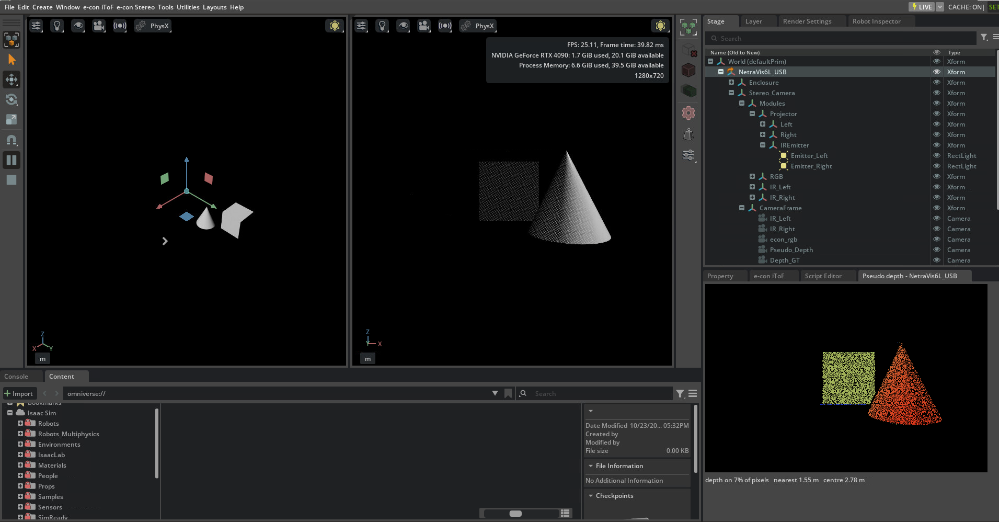

# e-con NetraVis6L_USB — Isaac Sim

Adds the **e-con NetraVis6L_USB active stereo camera** to Isaac Sim's camera and depth sensors:
an IR stereo pair, an RGB camera, an IR dot projector and an IMU, with ROS 2 publishing built
into the camera asset.

| Extension | Role |
|-----------|------|
| `econ.netravis.menu` | Adds the NetraVis6L_USB camera asset (**Create → Sensors → Camera and Depth Sensors → e-con**). |

## Requirements

- **NVIDIA Isaac Sim 5.1.0 or later**, on Linux or Windows.
- The IR dot projector needs **Isaac Sim 6.0 or later** (see [IR dot projector](#ir-dot-projector)).

## Installation

Clone this repository, then run the installer from inside it.

```bash
git clone https://github.com/econsystems/NetraVis-IsaacSim-Camera.git
cd NetraVis-IsaacSim-Camera
```

**Linux**
```bash
./build.sh
```

**Windows**
```bat
build.bat
```

- Auto-detects Isaac Sim. If several installs are found, it lists them and asks which one to
  use; if none is found, it asks for the folder.
- Installs the extension into `extsUser` inside the Isaac Sim folder — self-contained, so the
  cloned folder can be deleted afterwards — and loads it on every launch.
- Remove it with the [uninstaller](#uninstallation), not by deleting files manually.

To target a specific Isaac Sim install and skip auto-detection, set `ISAACSIM_PATH`:

```bash
ISAACSIM_PATH=/path/to/isaacsim ./build.sh                    # Linux
```
```bat
set ISAACSIM_PATH=C:\path\to\isaacsim & build.bat             :: Windows
```

## Usage

1. Relaunch Isaac Sim if it is already running.
2. Open **Create → Sensors → Camera and Depth Sensors → e-con**.
3. Select **NetraVis6L_USB** — added under `/World` as `NetraVis6L_USB`; a second camera becomes
   `NetraVis6L_USB_01`.

The camera asset is in metres and faces **+Y** with **+Z** up.

## The camera

| Prim (under `Stereo_Camera/`) | Sensor | Resolution | Lens |
|---|---|---|---|
| `CameraFrame/IR_Left`, `CameraFrame/IR_Right` | SmartSens SC132GS, monochrome, 850 nm, global shutter; 100.086 mm baseline | 1080×1280 | fisheye (OpenCV fisheye model), factory calibration per camera |
| `CameraFrame/econ_rgb` | OmniVision OV9782, global shutter | 1280×720 | pinhole with OpenCV distortion, factory calibration |
| `CameraFrame/Depth_GT` | ground-truth depth in the camera's depth frame (see [Depth](#depth)) | 1080×720 | pinhole, fx 559.2 |
| `CameraFrame/Pseudo_Depth` | camera for Isaac Sim's pseudo depth (see [Pseudo depth](#pseudo-depth)) | 1080×720 | pinhole, fx 559.2 |
| `Modules/Projector/IREmitter/Emitter_Left`, `Emitter_Right` | IR dot projector, **off** by default | — | 100°×90° |
| `IMU/ImuBody/IsmImuSensor` | 6-axis IMU | — | — |

The IR cameras show the raw IR image at 1080×1280 (portrait), through their fisheye lenses.
Depth uses the camera's depth frame: the rectified right view, 1080×720 pinhole (fx 559.2), at
the right IR camera's position — the same geometry as the real camera's depth output.

## ROS 2 publishing

ROS 2 is built into the camera asset as a variant. Select the camera, set **ROS** to **Enabled**
in *Property → Variants*, and press **Play** — the camera publishes its topics with no script or
extension.

> Uses the ROS 2 libraries bundled with Isaac Sim (`isaacsim.ros2.bridge`) — no system ROS 2 is
> needed to publish. A ROS 2 installation is needed only on the receiving side (RViz,
> `ros2 topic echo`).

| Topic | Type | Content |
|---|---|---|
| `/NetraVis6L_USB/ir_left/image` | `sensor_msgs/Image`, 1080×1280 | left IR image |
| `/NetraVis6L_USB/ir_left/camera_info` | `sensor_msgs/CameraInfo` | left IR camera info |
| `/NetraVis6L_USB/ir_right/{image, camera_info}` | as above | right IR |
| `/NetraVis6L_USB/depth/image` | `sensor_msgs/Image` `32FC1`, 1080×720 | **ground-truth depth** in metres, in the camera's depth frame (see [Depth](#depth)) |
| `/NetraVis6L_USB/depth/camera_info` | `sensor_msgs/CameraInfo` | pinhole intrinsics of the depth frame (fx = fy = 559.2, cx 540, cy 360) |
| `/NetraVis6L_USB/rgb/{image, camera_info}` | `sensor_msgs/Image`, 1280×720 | RGB |
| `/NetraVis6L_USB/imu` | `sensor_msgs/Imu` | IMU |
| `/NetraVis6L_USB/tf` | `tf2_msgs/TFMessage` | `world` → `ir_left`, `ir_right`, `rgb`, `depth`, `imu` |
| `/clock` | `rosgraph_msgs/Clock` | shared simulation clock (not namespaced) |

- Camera frames follow the ROS optical convention (+Z forward, +Y down).
- The IR and RGB `camera_info` describe a pinhole camera; for the IR cameras it does not model the
  fisheye lens. The depth `camera_info` is exact: the depth frame is a pinhole camera.
- Publish rates follow the simulation rate; the RGB camera publishes every second frame.

### Multiple cameras

Give each camera its own namespace so their topics do not collide: after enabling ROS, select
the camera's `Stereo_Camera` prim and edit *Property → Namespace* — e.g. `NetraVis6L_USB_01`,
`NetraVis6L_USB_02`, … All of that camera's topics, including `imu` and `tf`, move with it. The
[e-con camera control extension](#e-con-camera-control-extension) does this automatically.

### Depth

`/NetraVis6L_USB/depth/image` is Isaac Sim's **ground truth**: the exact distance to the image
plane, in metres, for every pixel (`inf` where nothing is hit). It is rendered from the
`Depth_GT` camera, which has the geometry of the real NetraVis6L_USB depth output — rectified
right view, 1080×720 pinhole, fx 559.2 — so a simulated depth frame lines up pixel for pixel with
a real one. It is not a simulation of the real camera's stereo matching or its errors (for a
stereo-like approximation, see [Pseudo depth](#pseudo-depth)).

### Viewing in RViz

- Set the **Fixed Frame** to `world`.
- `/tf` is namespaced per camera, so remap it to the camera you want:

```bash
ros2 run rviz2 rviz2 --ros-args -r /tf:=/NetraVis6L_USB/tf -r /tf_static:=/NetraVis6L_USB/tf_static
```

- To show an image, use **Add** → **By topic** → pick the topic → **Image**. Don't type an image
  topic into a display of another kind: RViz then fails to subscribe and can exit.
- **Depth** (`/NetraVis6L_USB/depth/image`) is in metres (`32FC1`): in its Image display, turn
  **Normalize Range** off and set **Min Value** 0 and **Max Value** 6, so 0–6 m map to black–white.
  With the default settings depth can look black.

## IR dot projector

The camera projects an IR dot pattern that gives the stereo pair texture to match on. It has
two emitters, `Emitter_Left` and `Emitter_Right`, which together cover the field of view of
both IR cameras.

- **Switch it on:** in the Stage panel, click the eye icon on `Emitter_Left` and `Emitter_Right`
  (under `Stereo_Camera/Modules/Projector/IREmitter`). It ships **off**. The
  [e-con camera control extension](#e-con-camera-control-extension) has a single checkbox for it.
- **Brightness:** `inputs:intensity` on each emitter (default 1.0).
- **Scene lighting:** Isaac Sim has no infrared, so every scene light also reaches the IR
  cameras. Bright lights (e.g. a dome light) wash the dots out at a distance; keep scene
  lighting dim when you need the dots far away.
- **RGB camera:** the dots are visible in the RGB image too. Switch the projector off for clean
  RGB frames.
- **Isaac Sim 5.1:** the projector shows as a flat patch instead of a dot field. Use 6.0 or later.

## Pseudo depth

The asset includes a template for Isaac Sim's **single-view depth sensor** — NVIDIA's generic
model of a stereo depth camera — set up with this camera's geometry: the `econ_PseudoDepth_ir`
render product on the `Pseudo_Depth` camera (1080×720, the device's rectified depth frame).

**It is a generic stereo approximation, not NetraVis6L_USB depth.** Use it to see how a stereo
camera with this baseline and field of view behaves in your scene, not to predict the exact
depth the real camera would output.

| What it does | What it does not do |
|---|---|
| Stereo range limits from this camera's geometry (100 mm baseline, 559.2 px focal length, 0.38–6 m cut-offs) | Reproduce NetraVis6L_USB depth noise or accuracy |
| Leaves gaps where the scene has no texture, as stereo matching does | Reproduce the NetraVis6L_USB matcher's own artefacts (edges, reflections, fine structures) |
| Benefits from the [IR dot projector](#ir-dot-projector): its dots add texture, so turn it on | Measure closer than **1 m** — see below |

**Range: 1 m to 6 m.** The sensor only produces correct depth when the depth camera's near
clipping plane is 1 m (the USD default), so anything closer than 1 m has no depth. The real
camera measures from 0.38 m. Do not lower the `Pseudo_Depth` camera's clipping range: below
1 m the sensor returns no depth or wildly wrong depth.

For accurate depth, use the renderer's ground truth instead: attach the
`distance_to_image_plane` annotator to a render product on a camera with the same geometry.

More about the sensor and its settings:
- [Isaac Sim — Single-View Post-Processing Pipeline](https://docs.isaacsim.omniverse.nvidia.com/6.0.1/sensors/isaacsim_sensors_camera_depth.html#single-view-post-processing-pipeline)
- [OmniSensorDepthSensorSingleViewAPI — attribute reference](https://docs.omniverse.nvidia.com/kit/docs/omni.usd.schema.omni_sensors/latest/omni_sensors_schema.html#omnisensordepthsensorsingleviewapi)

### Using it

**Live view:** add a NetraVis6L_USB camera, then in **Window → Script Editor** open
[`examples/pseudo_depth/netravis_pseudo_depth.py`](examples/pseudo_depth/netravis_pseudo_depth.py)
(**File → Open**) and click **Run**. It presses **Play** and opens a window for each camera
showing its pseudo depth (near = red, far = blue, black = no depth), with the share of pixels
that have depth, the nearest distance and the distance at the image centre. In the same Script
Editor tab, `get_depth()` then returns the latest frame as a numpy array (720 × 1080, metres;
0 = no depth) for your own code, and `stop()` closes the windows.



**In your own code**, the same takes a few lines. The template is the `econ_PseudoDepth_ir` prim
directly under the camera (`/World/NetraVis6L_USB/econ_PseudoDepth_ir`); select it in the Stage
panel to see its settings in *Property* — baseline, focal length, sensor size, maximum disparity
and range cut-offs, as `omni:rtx:post:depthSensor:*` attributes. It only holds the settings; to
get depth, create a render product from it:

```python
import carb, omni.usd
import omni.replicator.core as rep

stage = omni.usd.get_context().get_stage()
unit = "/World/NetraVis6L_USB"
template = stage.GetPrimAtPath(f"{unit}/econ_PseudoDepth_ir")
rp = rep.create.render_product(f"{unit}/Stereo_Camera/CameraFrame/Pseudo_Depth", (1080, 720))
rp_prim = stage.GetPrimAtPath(rp.path)
for k in ("renderSettings", "camera", "renderProduct"):
    carb.settings.get_settings().set(f"/exts/omni.usd.schema.render_settings/rtx/{k}/apiSchemas/autoApply", None)
rp_prim.ApplyAPI("OmniSensorDepthSensorSingleViewAPI")
for a in template.GetAttributes():                    # the template's sensor settings
    if a.GetName().startswith("omni:rtx:post:depthSensor:") and a.HasAuthoredValue():
        rp_prim.GetAttribute(a.GetName()).Set(a.Get())
rp_prim.GetAttribute("omni:rtx:post:depthSensor:enabled").Set(True)
depth = rep.AnnotatorRegistry.get_annotator("DepthSensorDistance")
depth.attach(rp)

# with the simulation playing:
d = depth.get_data()          # numpy, 720 x 1080, metres; 0 = no depth
```

The sensor's settings (range cut-offs, confidence threshold, …) are attributes on the render
product (`omni:rtx:post:depthSensor:*`); change them on `rp_prim` to suit your use, per the
attribute reference above.

## e-con camera control extension

Everything above — switching the IR projector, enabling ROS 2 with a separate namespace per
camera, and pseudo depth — is done from a single control window in the **e-con camera control
extension**, which also previews each output live, saves frames, and adds the sensors' RAW
images, rectified IR and colour output. *(Link coming soon.)*

## Examples

- [**Nova Carter navigation with nvblox**](examples/example1/README.md) — four NetraVis6L_USB
  cameras on NVIDIA's Nova Carter publish ground-truth depth over ROS 2; nvblox fuses them into
  a 3D map and Nav2 drives the robot through a warehouse around the obstacles the cameras see.

## Uninstallation

```bash
./uninstall.sh          # Linux
uninstall.bat           # Windows
```

Removes the extension from Isaac Sim and from its start-up list; other extensions are left
alone. To target a specific install, set `ISAACSIM_PATH` as for the installer.

## Notes

- Re-run the installer after reinstalling or updating Isaac Sim.
