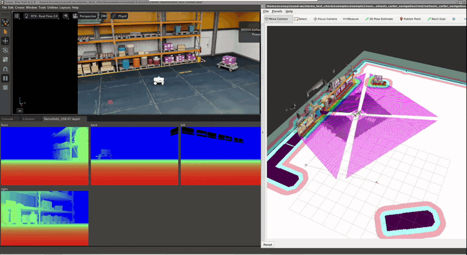

# Example 1 — Nova Carter with four NetraVis6L_USB cameras: nvblox navigation

Isaac Sim's **Nova Carter** is an autonomous mobile robot (AMR) reference platform. This example
mounts four NetraVis6L_USB cameras on it (front / back / left / right), publishes each camera's
**ground-truth depth** over ROS 2, fuses the four depth streams into a 3D map with
[**nvblox**](https://nvidia-isaac-ros.github.io/repositories_and_packages/isaac_ros_nvblox/index.html),
and lets **Nav2** plan around the obstacles nvblox sees while the Carter drives through a
warehouse.

## How it works

```
Isaac Sim (scene + streaming script)                  ROS 2 Humble (your terminal)
────────────────────────────────────                  ──────────────────────────────────────────
4 x NetraVis6L_USB  ── /netravis/<side>/depth ───────► nvblox ── 3D map ── 2D obstacle slice ─┐
   (Depth_GT camera)   /netravis/<side>/color            (fuses the 4 cameras;                  │
                       /netravis/<side>/camera_info       colour only paints the mesh)          │
                       /tf  (camera frames)                                                     ▼
Nova Carter         ── /front_3d_lidar/lidar_points ─► /scan ── AMCL (localisation) ─► Nav2 costmaps
                       /chassis/odom, /tf, /clock                                        + planner
                   ◄── /cmd_vel ─────────────────────────────────────────────────────── controller
```

- **Cameras** — each NetraVis6L_USB has a `Depth_GT` camera (part of the camera asset, the same
  depth its ROS variant publishes on `/NetraVis6L_USB/depth/image`): the camera's depth frame (1080×720,
  pinhole, fx 559.2 px, at the right IR camera's position — the geometry of the real camera's
  depth output) with a 0.002 m near clip. The streaming script publishes its **ground-truth
  depth** (exact distances from the renderer), its `camera_info`, and a **colour image** of the
  same view (same render, pixel-aligned with the depth, about 10 Hz).
- **Colour** is used by nvblox only to paint its 3D mesh; obstacles come from depth alone. It is a
  simulation aid: the real NetraVis6L_USB has no colour image in its depth frame (its RGB camera
  sits beside the IR pair, with its own lens).
- **nvblox** fuses the four depth streams into a 3D map and publishes a 2D slice of the
  obstacles between 0.09 m and 0.65 m above the floor.
- **Nav2** uses that slice for obstacles in its local and global costmaps
  (`nvblox::nav2::NvbloxCostmapLayer`); the global costmap also uses the warehouse map.
- **AMCL** localises the Carter on the warehouse map with its 3D lidar, flattened to `/scan`.

The depth is ground truth, not a simulation of the NetraVis6L_USB's own stereo depth or its
errors. (For a generic stereo approximation, see [Pseudo depth](../../README.md#pseudo-depth)
in the main README.)

### Camera mounting

Each camera is the NetraVis6L_USB asset from this repository, under the Carter's
`chassis_link/sensors`, about 0.35 m above the floor, facing outward:

| Side | Translate (robot frame, m) | Faces | Rotate Z |
|------|----------------------------|-------|----------|
| Front | (0.117, 0.000, 0.346) | +X | −90° |
| Back  | (−0.581, 0.000, 0.346) | −X | 90° |
| Left  | (−0.355, 0.167, 0.346) | +Y | 0° |
| Right | (−0.355, −0.167, 0.346) | −Y | 180° |

## What is in this folder

| Path | What it is |
|------|------------|
| [`assets/carter_warehouse_nav_scene.usd`](assets/carter_warehouse_nav_scene.usd) | The scene: the Carter with the four cameras in a compact warehouse. |
| [`assets/Nova_Carter_ROS_econ_NetraVis.usd`](assets/Nova_Carter_ROS_econ_NetraVis.usd) | The robot only, for use in your own scene. |
| [`netravis_nova_carter_ros.py`](netravis_nova_carter_ros.py) | Streaming script, run in Isaac Sim's Script Editor. |
| [`navigation/`](navigation) | ROS 2 workspace with the `netravis_carter_navigation` package: launch file, nvblox configuration, Nav2 parameters, map, RViz layout. Based on NVIDIA's [`carter_navigation`](https://github.com/isaac-sim/IsaacSim-ros_workspaces/tree/main/humble_ws/src/navigation/carter_navigation). |

The robot references the camera asset in [`exts/econ.netravis.menu/assets`](../../exts/econ.netravis.menu/assets),
so keep the repository's folder structure. The warehouse is loaded from NVIDIA's Isaac Sim
asset server, so the first load needs an internet connection.

## Requirements

- **Ubuntu 22.04, x86_64, NVIDIA RTX GPU.**
- **Isaac Sim 6.0.1 or later**, with this repository's extension installed — see the
  [main README](../../README.md#installation).
- **ROS 2 Humble** with Nav2: `ros-humble-navigation2`, `ros-humble-nav2-bringup`,
  `ros-humble-pointcloud-to-laserscan`.
- **nvblox** from NVIDIA Isaac ROS 3.2, and the **NVIDIA VPI** library it needs (step 1).

> The camera asset itself publishes through the ROS 2 libraries bundled with Isaac Sim. This
> example additionally needs a full **ROS 2 Humble** installation, because Nav2, nvblox and
> RViz run as ROS 2 nodes outside the simulator.

## Step 1 — install nvblox (once)

```bash
# NVIDIA Isaac ROS apt repository (release 3, Humble)
sudo apt update && sudo apt install -y gnupg wget
wget -qO - https://isaac.download.nvidia.com/isaac-ros/repos.key | sudo apt-key add -
grep -qxF "deb https://isaac.download.nvidia.com/isaac-ros/release-3 $(lsb_release -cs) release-3.0" /etc/apt/sources.list || \
echo "deb https://isaac.download.nvidia.com/isaac-ros/release-3 $(lsb_release -cs) release-3.0" | sudo tee -a /etc/apt/sources.list
sudo apt-get update

# nvblox, its Nav2 costmap layer and its RViz plugin
sudo apt-get install -y ros-humble-nvblox-ros ros-humble-nvblox-nav2 ros-humble-nvblox-rviz-plugin

# NVIDIA VPI 3, which nvblox links against
wget https://repo.download.nvidia.com/jetson/x86_64/jammy/pool/main/libn/libnvvpi3/libnvvpi3_3.2.4_amd64.deb
sudo dpkg -i libnvvpi3_3.2.4_amd64.deb
```

Check that nvblox starts (stop it with Ctrl+C after a few seconds of log output):

```bash
source /opt/ros/humble/setup.bash
ros2 run nvblox_ros nvblox_node
```

## Step 2 — build the navigation workspace (once)

```bash
source /opt/ros/humble/setup.bash
cd <this repository>/examples/example1/navigation
colcon build
```

## Step 3 — start Isaac Sim with ROS 2

In **terminal A**. Do **not** source `/opt/ros/humble` in this terminal: Isaac Sim uses its own
bundled ROS 2 libraries, and mixing in the system ones can crash it.

```bash
cd <isaac sim folder>
export ROS_DISTRO=humble
export RMW_IMPLEMENTATION=rmw_fastrtps_cpp
export LD_LIBRARY_PATH=$LD_LIBRARY_PATH:$PWD/exts/isaacsim.ros2.core/humble/lib
export ROS_DOMAIN_ID=0              # use the same value in every terminal of this example
./isaac-sim.sh
```

## Step 4 — open the scene and start the cameras

1. **File → Open** →
   [`examples/example1/assets/carter_warehouse_nav_scene.usd`](assets/carter_warehouse_nav_scene.usd).
   Wait until the warehouse has finished loading.
2. **Window → Script Editor** → **File → Open** →
   [`examples/example1/netravis_nova_carter_ros.py`](netravis_nova_carter_ros.py) → **Run**.

The script presses **Play**, and the Script Editor's console shows:

```
[netravis] publishing 4 camera(s), domain 0, TF parent .../chassis_link/base_link
    /netravis/front/{depth, color, camera_info}   frame netravis_front_depth   (...)
    /netravis/back/{depth, color, camera_info}   frame netravis_back_depth   (...)
    /netravis/left/{depth, color, camera_info}   frame netravis_left_depth   (...)
    /netravis/right/{depth, color, camera_info}   frame netravis_right_depth   (...)
```

A window **NetraVis6L_USB GT depth** opens with the four depth images (near = red, far = blue,
black = nothing in range).

## Step 5 — check the topics

In **terminal B**:

```bash
source /opt/ros/humble/setup.bash
export ROS_DOMAIN_ID=0
ros2 topic list | grep netravis          # 12 topics: depth, color, camera_info for 4 cameras
ros2 topic hz /netravis/front/depth
ros2 topic hz /netravis/front/color      # about 10 Hz
```

## Step 6 — start nvblox and Nav2

In **terminal B**:

```bash
source <this repository>/examples/example1/navigation/install/setup.bash
ros2 launch netravis_carter_navigation netravis_carter_navigation.launch.py
```

RViz opens with the warehouse map. Within a few seconds:

- the Carter is localised at its start pose (AMCL starts from (−6, −1), facing −X, where the
  scene places the robot);
- the **nvblox mesh** (in the scene's colours) and the **Esdf Slice** (nvblox's obstacle slice) build up around the robot
  from the four cameras;
- the **local and global costmaps** show the obstacles nvblox found, with inflation around them.

## Step 7 — drive

In RViz, click **2D Goal Pose** and place a goal on free floor. The Carter plans a path and drives
to it, avoiding the obstacles the four cameras see. The mesh and the costmaps update as it moves.

Tested end to end on Isaac Sim 6.0.1, ROS 2 Humble, nvblox 3.2.5: the four depth streams fused
by nvblox, about 1,350 obstacle cells from nvblox in the 10 m × 10 m local costmap at the start
pose, and a goal 5.6 m away around a corner reached in 41 s.

To stop: Ctrl+C in terminal B, then `teardown()` in the Script Editor (or stop the simulation).

## Demo video



## Options

- **Without RViz** (e.g. on a remote machine): `ros2 launch ... rviz:=false`.
- **Another map**: `ros2 launch ... map:=<your_map.yaml>`.
- **Streaming script settings** at the top of `netravis_nova_carter_ros.py`: `PREVIEW_WINDOW`,
  `PREVIEW_SIZE`, `TOPIC_ROOT`, `PUBLISH_COLOR` (off: no colour topics, grey mesh),
  `COLOR_FRAME_SKIP` (colour rate). The ROS 2 domain is the `ROS_DOMAIN_ID` Isaac Sim was started
  with.

## Bring your own scene

Add [`assets/Nova_Carter_ROS_econ_NetraVis.usd`](assets/Nova_Carter_ROS_econ_NetraVis.usd) to any
Isaac Sim stage and run the streaming script; the topics and frames are the same. Navigation
then needs a map of your scene for AMCL and the global costmap (`map:=`), and an AMCL start
pose matching where you place the robot (`initial_pose` in
`params/netravis_carter_navigation_params.yaml`).

## Troubleshooting

| Symptom | Cause / fix |
|---|---|
| `nvblox_node: error while loading shared libraries: libnvvpi.so.3` | VPI is not installed — run the last two commands of [step 1](#step-1--install-nvblox-once). |
| No `/netravis/...` topics in terminal B | Isaac Sim and terminal B use different `ROS_DOMAIN_ID`s, or Isaac Sim was started without the ROS 2 environment of [step 3](#step-3--start-isaac-sim-with-ros-2). |
| `[netravis] no NetraVis6L_USB unit with a Depth_GT camera` | The example scene is not open (or not loaded yet). |
| Costmaps stay empty | nvblox receives no depth: check `ros2 topic hz /netravis/front/depth` and that the simulation is playing. |
| Isaac Sim crashes on start | `/opt/ros/humble` was sourced in terminal A — use a fresh terminal. |
